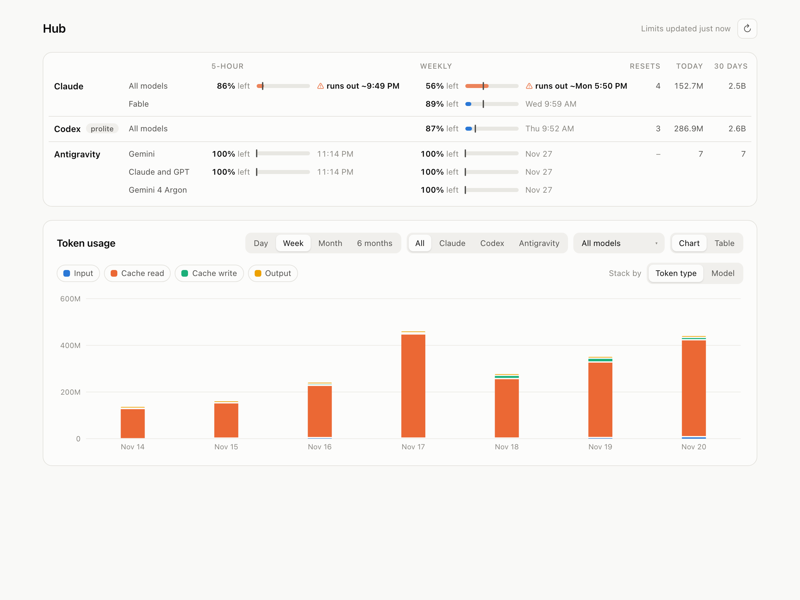

# hubdash

A small new-tab dashboard for Claude, Codex, Antigravity, and Z.ai subscriptions routed through
[CLIProxyAPI](https://github.com/router-for-me/CLIProxyAPI). It shows how much of each rate limit is left and
where your tokens went.

<picture>
  <source media="(prefers-color-scheme: dark)" srcset="docs/screenshot-dark.png">
  
</picture>

## What it shows

- **Stat cards**: tokens today with an hourly sparkline, a countdown to the next reset, the tightest limit
  across every account, and how many resets are available to spend.
- **A limits table**: a row per provider and model group (Claude's Fable, Antigravity's Gemini, …), a column
  per window (5-hour, weekly). Each cell is a ring showing how much is used with a tick for how far through
  the window you are, and when it resets, or a warning if you're on pace to run out first. Hover a cell for
  usage and a pace estimate.
- **Resets available** and **tokens** today and over the last 30 days, at the end of each provider's rows. Hover
  for what each reset refills and when it expires, or for the token breakdown.
- **Token usage over time** for a day, week, month, or 6 months. Filter by provider or model, stack by token
  type (input, cache read, cache write, output) or by model, or switch to a table.
- **A daily-usage heatmap** over the last year, GitHub-style.

## How it works

One Bun binary serves the page and a small JSON API:

- **Limits** come from each provider's usage endpoint, called through CLIProxyAPI's management API
  (`/v8/management/requests/api-call`), so the proxy supplies the account's OAuth token or API key. They're refreshed every 5 minutes.
  Accounts are listed by `/v8/management/credentials`; keys configured under `openai-compatibility` aren't in that listing,
  so their auth-index comes from `/v0/management/openai-compatibility`.
- **Token usage** is read from the SQLite database kept by
  [CPA-Manager-Plus](https://github.com/seakee/CPA-Manager-Plus) (`usage_events`).

The usage endpoints (`api.anthropic.com/api/oauth/usage`, `chatgpt.com/backend-api/wham/usage`,
`cloudcode-pa.googleapis.com/v1internal:retrieveUserQuotaSummary`, `api.z.ai/api/monitor/usage/quota/limit`) are
undocumented and may change. If one fails, that account shows "Limits unavailable" and the rest of the page keeps working.

## Requirements

- CLIProxyAPI with the management API enabled, and CPA-Manager-Plus recording usage, on the same machine
- [Bun](https://bun.sh) to build (the server machine only needs the compiled binary)

## Configuration

| Variable       | Default                              | Purpose                                        |
| -------------- | ------------------------------------ | ---------------------------------------------- |
| `PORT`         | `18400`                              | Port to listen on (always binds `127.0.0.1`)   |
| `PROXY_URL`    | `http://127.0.0.1:8317`              | CLIProxyAPI base URL                           |
| `SECRETS_FILE` | `~/cliproxyapi/secrets.env`          | File containing a `MGMT_KEY=` line             |
| `USAGE_DB`     | `~/cpamp/data/usage.sqlite`          | CPA-Manager-Plus database (opened read-only)   |
| `CLAUDE_CODE_VERSION` | `2.1.327`                     | Claude Code version sent when reading reset grants; Anthropic hides them from old versions |
| `ANTIGRAVITY_VERSION` | `2.34.0`                      | Antigravity Hub version sent when reading quotas; Google hides the Gemini groups from old versions |

## Development

```sh
bun install
bun test
bun run typecheck
bun run dev        # needs the proxy and usage DB reachable, e.g. over an ssh tunnel
```

## Deploying

`./deploy <ssh-host>` runs the tests and typecheck, builds a `linux-x64` binary, copies it and
`hubdash.service` to the host, and restarts it as a systemd user service. (`HUB_HOST` works instead of the
argument.) To keep it running after you log out, the user needs lingering (`loginctl enable-linger`).

The service only listens on localhost. To reach it from your other devices, put something in front of it, for
example [Tailscale Serve](https://tailscale.com/kb/1312/serve):

```sh
sudo tailscale serve --bg --https=443 http://127.0.0.1:18400
```

Then set that URL as your browser's homepage or new-tab page.
